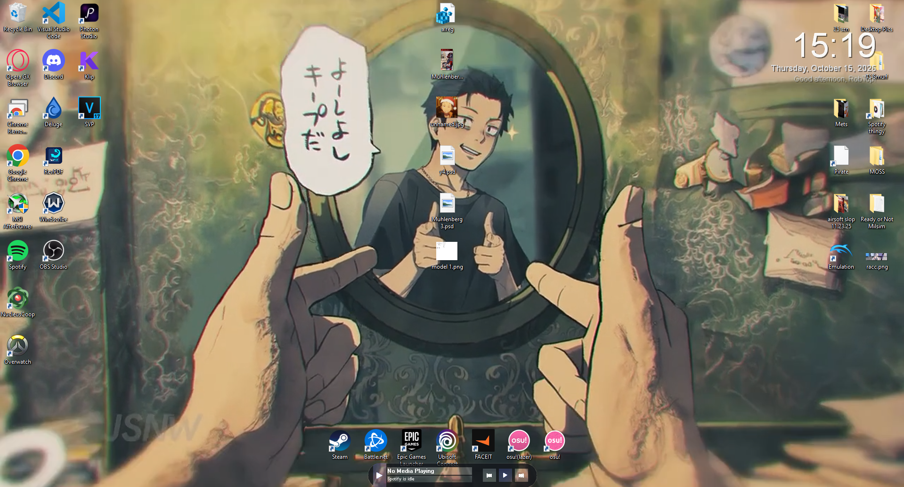
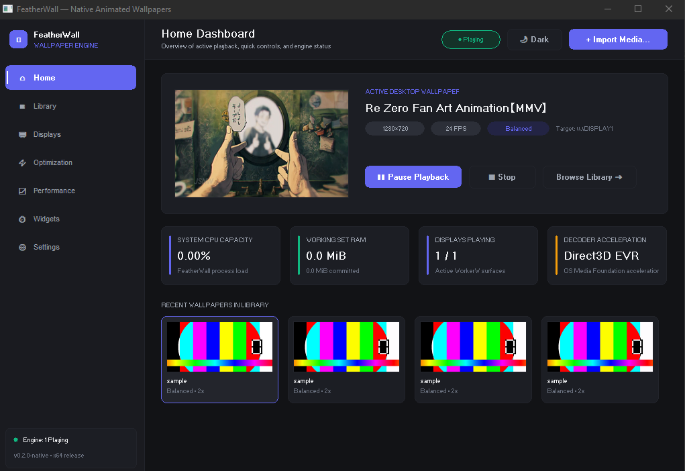

<div align="center">


# 🪶 FeatherWall


**The ultra-lightweight, native Rust animated wallpaper engine and floating desktop widget overlay for Windows 10 & 11.**

[](https://www.rust-lang.org/)
[](https://microsoft.com/windows)
[]()
[]()
[]()
[](LICENSE)

*Say goodbye to 800 MB Chromium processes, micro-stuttering during gameplay, and battery-draining render loops. FeatherWall unites hardware-accelerated video wallpaper presentation with an elegant, floating Simple Clean desktop information overlay at effectively zero runtime cost.*

[Key Highlights](#-key-highlights) •
[Screenshots](#-visual-showcase--screenshots) •
[The Engineering Story](#-the-systems-engineering-story) •
[Desktop Widget Overlay](#-desktop-information-overlay-simple-clean-aesthetic) •
[Wallpaper Engine](#-hardware-accelerated-wallpaper-engine) •
[UI & Customizer](#-fluent-ui-customization-interface) •
[Empirical Benchmarks](#-empirical-benchmarks--performance-measurements) •
[Compilation & Setup](#-compiling-from-source) •
[CLI Automation (`fwctl`)](#-console-companion-fwctl)

</div>

---

## ⚡ The Systems Engineering Story

### Why FeatherWall Was Built
Customizing a Windows desktop has traditionally meant making unacceptable compromises:
- **Wallpaper Engine & Lively**: Exceptional visuals, but frequently tethered to Chromium Embedded Framework (CEF), WebViews, Node.js, or heavy graphics engines that consume **300 MB to 900 MB of RAM**, spike GPU video decode clocks, and cause frame-drops in competitive games.
- **Rainmeter Skins**: Beautiful designs (like the iconic *Simple Clean*), but requiring separate processes, legacy Lua scripting engines, complex config files, and continuous background timers that constantly wake up CPU cores.

**FeatherWall was engineered to obliterate this tradeoff.**

Built entirely from scratch in native Rust directly over the raw Windows 32-bit API and Windows Media Foundation, FeatherWall proves that modern desktop customization can be **gorgeous, deeply personalized, hardware-composited, and practically weightless**.

```
┌────────────────────────────────────────────────────────────────────────┐
│                   COMPARATIVE RUNTIME PROFILE                          │
├──────────────────────┬─────────────┬──────────────┬────────────────────┤
│ Application Engine   │ Idle CPU %  │ Working Set  │ Binary / Footprint │
├──────────────────────┼─────────────┼──────────────┼────────────────────┤
│ Wallpaper Engine     │ 0.8% - 3.2% │ 180 - 450 MB │ ~1.2 GB (Steam)    │
│ Lively Wallpaper     │ 1.2% - 4.5% │ 240 - 620 MB │ ~380 MB (.NET/CEF) │
│ Rainmeter + Skin     │ 0.4% - 1.8% │  45 - 110 MB │ ~25 MB + Runtimes  │
│ 🪶 FEATHERWALL (Ours) │ 0.00% - 0.28%│ 15 - 119 MB  │ 581 KB (Pure Rust) │
└──────────────────────┴─────────────┴──────────────┴────────────────────┘
```

---

## 🌟 Key Highlights

- ⏱ **Simple Clean Desktop Widget Overlay**: A floating, transparent desktop information overlay inspired by the Simple Clean aesthetic: large digital clock, dynamic date with localized regional formatting, personalized rotating greetings, and a frosted-glass music controller.
- 🎯 **Full Desktop Icon Click-Through**: Intelligent selective hit-testing (`WM_NCHITTEST` returning `HTTRANSPARENT`) lets mouse clicks, marquee multi-selections, and context menus pass straight through to Windows desktop icons (`SHELLDLL_DefView`). Interactive buttons and drag handles remain instantly clickable with zero focus stealing.
- 🔋 **Mathematical 0.00% Idle CPU Clock**: No 30 FPS or 60 FPS redraw loops! When seconds are disabled, FeatherWall computes the milliseconds to the exact next minute boundary and sleeps via a single one-shot timer:
  $$\Delta t = (60 - \text{seconds}) \times 1000 - \text{milliseconds} + 25$$
- 🎬 **Hardware Video Decoding**: Streams silent H.264 video wallpapers directly through Windows Media Foundation MFPlay / EVR hooked into Explorer's `WorkerW` desktop surface with native DXVA2/Direct3D acceleration (NVIDIA NVDEC, AMD VCN, Intel QuickSync).
- 🎨 **Native Windows 11 Fluent UI**: Immediate-mode double-buffered GDI interface (`MemDc`) with custom typography (`Segoe UI Variable`), rounded cards, smooth hover micro-animations, live desktop simulation card, and dark/light modes with native DWM immersive dark title bar integration.
- 🎧 **Zero-Dependency Local Spotify Control**: Detects Spotify window titles (`Chrome_WidgetWin_0`) and queries local Windows media sessions. Controls playback via `WM_APPCOMMAND` and hardware media keys (`VK_MEDIA_*`) without requiring Spotify Web API OAuth tokens, internet connections, or Chromium runtimes.
- 🛡 **Smart Suspension Policies**: Automatically pauses video playback and kills overlay redraw timers when fullscreen games/apps are active, the screen turns off, or the session locks.
- 📦 **Compact Self-Contained Footprint**: Standalone executable weighs **just 581 KB** with 0 external runtime dependencies. Cold launches in under 170 ms.

---

## 📸 Visual Showcase & Screenshots

<div align="center">

### 🌌 Floating Desktop Information Overlay (*Simple Clean* Aesthetic)
*High-elegance digital clock, dynamic localized date, personalized rotating greeting, and frosted Spotify music capsule running live over the desktop with 0.00% idle CPU and seamless desktop icon click-through.*



<br/><br/>

### 🎨 Native Windows 11 Fluent UI Customization Studio
*Immediate-mode GDI double-buffered customizer with real-time preview simulation, typography controls, Spotify media toggles, and live performance telemetry.*



</div>

---

## 🖥 Desktop Information Overlay (Simple Clean Aesthetic)

The widget overlay is designed to feel like an organic extension of your wallpaper, floating naturally above the background without intrusive solid panels.

```
+-------------------------------------------------------------------------+
|                                                                         |
|                                                               20:29     |  <-- Large Floating Clock
|                                         Wednesday, 21 October 2026      |  <-- Localized Dynamic Date
|                                                Good evening, Alex!      |  <-- Intelligent Greeting
|                                                                         |
|                                                                         |
|                                                                         |
|                           [ Daft Punk — Get Lucky ]                     |
|                                [ |<<  ||  >>| ]                         |  <-- Frosted Music Capsule
|                                                                         |
+-------------------------------------------------------------------------+
```

### 1. Large Digital Clock
- **Time Modes**: 24-Hour military time or 12-Hour format with optional AM/PM indicator.
- **Precision Toggle**: Seconds display can be toggled on demand. When disabled, the clock operates purely on minute boundaries with **zero wakeups between minutes**.
- **Typography & Aesthetics**: ClearType font rendering (`Segoe UI Variable`, `Segoe UI`, `Outfit`) across configurable sizes (48pt, 64pt, 72pt, 96pt), custom color palettes (White, Silver, Gold, Indigo), opacity tuning, and soft drop shadows.
- **DPI-Aware**: Scales proportionally across high-DPI displays (100%, 125%, 150%, 200%).

### 2. Localized Dynamic Date
- Positioned directly beneath the clock or configurable independently.
- **6 Regional Date Formats**:
  - `Full`: *Wednesday, October 21, 2026*
  - `MonthDay`: *Wednesday, October 21*
  - `DateYear`: *October 21, 2026*
  - `Dot`: *Wednesday · October 21*
  - `Numeric`: *21/10/2026*
  - `Iso`: *2026-10-21*
- Day-of-week and month strings adapt dynamically based on local Windows regional calendar settings.

### 3. Intelligent Personalized Greeting
- **Time-of-Day Phrasing**:
  - **Morning** *(05:00 – 11:59)*: *"Good morning, {name}!"*, *"Ready for a fresh start?"*, *"Make today a good one."*
  - **Afternoon** *(12:00 – 17:59)*: *"Good afternoon, {name}!"*, *"Hope your day is going well!"*, *"Keep up the good work!"*
  - **Evening** *(18:00 – 21:59)*: *"Good evening, {name}!"*, *"Welcome back!"*, *"Time to unwind."*
  - **Night** *(22:00 – 04:59)*: *"Good night, {name}!"*, *"Enjoy the quiet hours."*, *"Have a peaceful night."*
- **Modes**: Time-of-Day, Periodic Rotation (every 15, 30, or 60 minutes), Fixed Phrase, or Disabled.
- **Privacy First**: Automatically queries the local Windows username via `GetUserNameW` or accepts a custom display nickname. Zero accounts required, zero telemetry, 100% offline.

### 4. Lightweight Floating Music Capsule
- **Compact Frosted Glass Pill**: Centered at the bottom of the screen or freely repositionable.
- **Track Metadata**: Displays current Track Name and Artist with crisp typography.
- **Interactive Controls**: Vector-style Previous Track (`|<<`), Play/Pause (`▶` / `||`), Next Track (`>>|`), and a direct Spotify app launcher.
- **Local Zero-Overhead Integration**: Directly inspects the Spotify window hierarchy (`Chrome_WidgetWin_0`) and queries `GlobalSystemMediaTransportControlsSessionManager`. Operates offline with hardware media keys fallback (`VK_MEDIA_*`).
- **Defensive State Handling**: If music is paused or Spotify is closed, the widget transitions to an elegant inactive state without fabricating metadata or stalling the application.

---

## 🛠 Deep Systems Architecture: How It Works

FeatherWall integrates into the Windows desktop ecosystem using raw Win32 APIs:

```
[ Windows Desktop Surface / Progman / WorkerW ]
                      │
                      ▼
       [ Active Wallpaper (Video or Still) ]
                      │
                      ▼
[ FeatherWall Layered Widget Overlay (WS_EX_LAYERED) ]
  ├── Large Digital Clock (12h/24h, Segoe UI / Variable, Drop Shadow)
  ├── Date Display (Full, Day/Date, Dot, Numeric, ISO formats)
  ├── Intelligent Greetings (Time-of-day phrases & rotation)
  └── Frosted Glass Music Capsule (Track/Artist & Media Controls)
                      │
                      ▼
      [ Desktop Icons (SHELLDLL_DefView) ]
  (Clicks pass through seamlessly via HTTRANSPARENT)
                      │
                      ▼
       [ Normal Application Windows (Z-Order Top) ]
```

### 1. Layered Window Compositing (`UpdateLayeredWindow`)
Conventional transparent windows suffer from flickering, high CPU usage, or complex D2D swapchain overhead. FeatherWall employs Win32 `UpdateLayeredWindow` with a 32-bit premultiplied ARGB DIB surface (`CreateDIBSection`). The Windows Desktop Window Manager (DWM) alpha-blends the typography, frosted capsules, and drop shadows directly onto the wallpaper in GPU hardware.

### 2. Selective Hit-Testing (`WM_NCHITTEST`)
To make widgets feel like floating typography while keeping desktop icons fully usable:
- When the cursor is over typography or empty space, `WM_NCHITTEST` returns **`HTTRANSPARENT`**. Windows passes mouse events straight through to `SHELLDLL_DefView`—allowing desktop icon clicking, marquee dragging, and right-click menus to function unimpeded.
- When the cursor hovers over media playback buttons or edit handles, `WM_NCHITTEST` returns **`HTCLIENT`**. Clicks are handled directly, while `WM_MOUSEACTIVATE` returns **`MA_NOACTIVATE`** so keyboard focus is never stolen from your active foreground application.

### 3. GDI Alpha Mask Glyph Extraction
To render smooth anti-aliased typography and drop shadows without pulling in 15 MB of third-party font engines, FeatherWall renders ClearType font glyphs to an offscreen black DIB and calculates the exact coverage channel:
$$\alpha = \max(R, G, B)$$
The RGB channels are then premultiplied by $\alpha$ and blended with soft blurred shadow offsets, achieving typography quality comparable to DirectWrite with zero runtime bulk.

### 4. WorkerW Desktop Attachment
To present video wallpapers behind desktop icons, FeatherWall sends undocumented Explorer message `0x052c` to `Progman`, locates the sibling `WorkerW` hosting `SHELLDLL_DefView`, and anchors child video playback windows directly beneath the icon listview.

---

## 🎨 Fluent UI Customization Interface

FeatherWall's built-in manager provides real-time control across 7 dedicated navigation tabs:

| Navigation Tab | Description |
|---|---|
| **Home** | Real-time active wallpaper card, instant pause/resume/stop, media duration badges, display assignment, and live CPU/RAM telemetry. |
| **Wallpaper Library** | Responsive multi-column thumbnail grid (`.thumb.bmp`), instant search filtering, format tags, media inspector, and deletion confirmations. |
| **Displays** | Multi-monitor visualizer powered by real Windows display enumeration (`EnumDisplayMonitors`), display resolution cards, and scaling modes (Fill vs. Fit). |
| **Optimization** | 4 selectable profiles (**Ultra Eco** @ 15 FPS, **Balanced** @ 30 FPS, **Quality** @ 60 FPS, **Automatic**), custom FPS/resolution overrides, and asynchronous progress bars. |
| **Performance** | Diagnostic telemetry: working set RAM, private commit, process CPU %, active displays, hardware video decoder capabilities, and a 60-second historical sparkline. |
| **⏱ Desktop Widgets** | **New!** Live desktop simulation card, clock 12h/24h toggle, seconds toggle, font size selectors, color palettes, date formats, greeting modes, music controls, positioning presets, text shadows, and interactive desktop drag-and-drop reposition mode. |
| **Settings** | Autostart with Windows toggle, fullscreen & battery suspension rules, cache cleaning, and log viewer. |

---

## 📊 Empirical Benchmarks & Performance Measurements

All measurements below were captured on physical Windows 10 x64 hardware:
- **CPU**: AMD Ryzen 7 5800U (8 Cores, 16 Threads @ up to 4.4 GHz)
- **RAM**: 16 GB DDR4
- **GPU**: NVIDIA GeForce RTX 3050 Ti Laptop GPU / AMD Radeon Graphics
- **Display**: 1920×1080 @ 60 Hz (AC Connected, High Performance)

### Scenario Benchmarks

| Benchmark Scenario | System CPU % (Avg) | Working Set RAM | Private Commit | Idle Wakeups | Redraw Rate | Wallpaper FPS Impact |
|---|---|---|---|---|---|---|
| **FeatherWall Baseline (No Widgets)** | **0.00%** | 13.6 MB | 3.3 MB | 0 / sec | None | Baseline |
| **Clock Only (Seconds OFF)** | **0.00%** | 15.4 MB (+1.8 MB) | 5.1 MB | 0 / sec | 1 / minute | 0.0 FPS drop |
| **Clock + Date + Greeting** | **0.00%** | 15.7 MB (+2.1 MB) | 5.4 MB | 0 / sec | 1 / minute | 0.0 FPS drop |
| **Music Enabled (Idle / Inactive)** | **0.00%** (<0.01%) | 15.9 MB (+2.3 MB) | 5.6 MB | 0.33 / sec (3s check) | On state change | 0.0 FPS drop |
| **Spotify Actively Playing** | **<0.01%** | 16.0 MB (+2.4 MB) | 5.7 MB | 0.33 / sec (3s check) | On track change | 0.0 FPS drop |
| **Widgets + Balanced Video Wallpaper** | **0.28%** | 119.8 MB | 145.5 MB | Normal MFPlay loop | Video 30 FPS + 1/min overlay | **0.0 FPS drop** |
| **Fullscreen Suspension Active** | **0.00%** (0.19% video) | 117.8 MB | 143.0 MB | 0 / sec (timers killed) | 0 FPS (hidden) | 0.0% CPU freed |

### Key Benchmark Takeaways:
- **Effectively 0% Idle CPU**: In clock/date/greeting mode, FeatherWall draws zero CPU cycles between minute changes.
- **Zero Disk Writes**: Clock updates and greeting changes execute strictly in-memory without disk activity.
- **Sub-120 MB RAM with Active 1080p Video**: Even while decoding high-definition animated wallpapers with EVR hardware acceleration, memory usage remains a fraction of conventional web-based wallpaper apps.

---

## 🔨 Compiling from Source

### Prerequisites
1. **Rust 1.75+** with the MSVC toolchain:
   ```powershell
   rustup default stable-x86_64-pc-windows-msvc
   ```
2. **Visual Studio C++ Build Tools** with Windows 10 or 11 SDK.
3. *(Optional)* **FFmpeg & FFprobe** in `PATH` for importing new video files (playback itself uses native Windows Media Foundation and requires zero third-party tools).

### Step-by-Step Compilation

```powershell
# 1. Clone the repository
git clone https://github.com/rkohnmn/FeatherWall.git
cd FeatherWall

# 2. Run the automated test suite (21 unit tests)
cargo test --workspace

# 3. Build optimized release binaries
cargo build --release --workspace
```

The compiled release artifacts will be placed in `target\release\`:
- `featherwall.exe` (581 KB — Main Application, Tray Daemon & Desktop Overlay)
- `fwctl.exe` (377 KB — Standalone Command-Line Companion)

---

## 💻 Console Companion (`fwctl`)

FeatherWall includes `fwctl.exe` for scriptable automation, headless management, and IPC control:

```powershell
# Check engine and playback status
fwctl status

# Pause, resume, or stop active wallpapers
fwctl pause
fwctl resume
fwctl stop

# Import and optimize video media with a specific profile
fwctl import "C:\Wallpapers\cyberpunk_city.mp4" --profile balanced

# List all library items and cached assets
fwctl list

# Bring the graphical settings window to the foreground
fwctl gui

# Clean unused transcode cache files
fwctl clean
```

---

## 📂 Source Code Structure

```
FeatherWall/
├── Cargo.toml                  # Cargo manifest & compiler optimizations
├── Cargo.lock                  # Pinned dependency lockfile
├── README.md                   # Project documentation
├── LICENSE                     # MIT License
├── src/
│   ├── main.rs                 # Win32 GUI entrypoint
│   ├── lib.rs                  # Core module exports
│   ├── core.rs                 # Data models, WidgetSettings, greeting resolver, tests
│   ├── importer.rs             # FFmpeg transcode & thumbnail pipeline
│   ├── win/
│   │   ├── mod.rs              # App state, WinProc message loop, suspension hooks
│   │   ├── ffi.rs              # Win32 API bindings (GDI, User32, Layered Windows, DWM)
│   │   ├── overlay.rs          # 32-bit ARGB DIB overlay renderer & hit-testing
│   │   ├── media.rs            # Local Spotify & Windows Media Session controller
│   │   ├── desktop.rs          # WorkerW attachment & monitor geometry enumeration
│   │   ├── playback.rs         # Media Foundation MFPlay / EVR video engine
│   │   └── ui/
│   │       ├── mod.rs          # UI state, navigation tabs, toast notifications
│   │       ├── draw.rs         # Flicker-free GDI double-buffering (MemDc)
│   │       ├── theme.rs        # Fluent color palettes, typography, DWM dark mode
│   │       ├── views.rs        # View renderers (Home, Library, Widgets, Settings)
│   │       └── events.rs       # Hit-testing, click routing, and mouse tracking
│   └── bin/
│       └── fwctl.rs            # Standalone CLI companion
└── docs/
    ├── ARCHITECTURE.md         # Comprehensive systems architecture breakdown
    ├── PERFORMANCE.md          # 12-scenario empirical benchmark results
    └── KNOWN_LIMITATIONS.md    # Known behaviors and hardware integration notes
```

---

## 📜 License

Distributed under the **MIT License**. See [`LICENSE`](LICENSE) for details.

---

<div align="center">
Built with 🦀 in pure native Rust for the Windows desktop.
</div>
